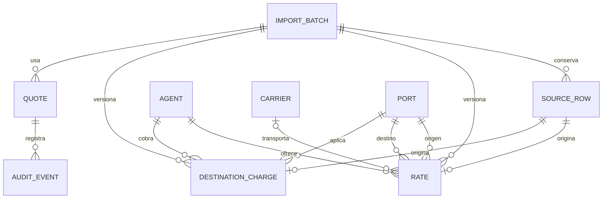

# Modernización del cotizador FCL

## Resumen ejecutivo y decisiones

**Fuente analizada:** `Cotizador_FCL_Automatico_Visual_Final_v6.xlsm`, 496.360 bytes.
SHA-256: `b4a6051c0d6b876af11e247dbf4f97a20749cbe99d37bf4a7adafcf3c0380db9`.
Fecha del análisis: 10 de noviembre de 2026.

El libro cotiza transporte marítimo FCL para combinaciones de contenedores 20 ST, 40 ST
y 40 HC. Consolida ofertas de agentes, agrega documentación y cargos en destino,
elige una oferta por agente, ordena por costo y conserva un histórico.
No gestiona reservas, facturas, clientes, impuestos ni pagos.

**Hallazgo decisivo:** hay tres capas de distinta antigüedad:

1. VBA instalado en `Module1`: motor realmente invocado por los botones.
2. Fórmulas en `Comparativo` y datos de `Tarifas`: motor anterior, aún recalculado pero
   no consultado por el procedimiento activo para seleccionar ofertas.
3. Código escrito como texto en la hoja `Macros` y explicaciones en `Guia`:
   documentación histórica, no código instalado. Incluye una carga VBA que no existe
   como procedimiento ejecutable.

Migrar solo las fórmulas o solo la hoja `Macros` produciría una aplicación diferente.

Decisiones confirmadas con el solicitante:

- **Modo estricto por defecto; compatibilidad VBA únicamente para auditoría.**
- **Prototipo local funcional**; autenticación empresarial y operación productiva en el roadmap.
- PostgreSQL recomendado para producción; SQLite se utiliza para desarrollo/demo.

Se preservan datos originales y trazabilidad; se conservan las reglas legítimas, pero no se
presentan fallos conocidos como comportamiento empresarial aceptable.
Las diferencias intencionales quedan identificadas en este documento y en las pruebas.

## 0. Método, evidencia y límites

Se inspeccionaron:

- Estructura ZIP/OOXML, diez hojas, estados de visibilidad, tablas, celdas no vacías,
  fórmulas, valores calculados almacenados, formatos, combinaciones y validaciones.
- Los doce módulos del proyecto VBA: un módulo estándar, diez módulos de hoja y
  `ThisWorkbook`. Se extrajo el código completo con `oletools`.
- Controles VML, propiedades de controles, dibujos, relaciones, nombres definidos,
  cinco conexiones y el paquete DataMashup que contiene las consultas M de Power Query.
- Todas las fórmulas de `Comparativo`, agrupadas por traducción de referencias:
  quince familias, cada una repetida 407 veces. Se revisó además el texto íntegro de `Macros`.

Evidencia reproducible:

- [Inventario y perfil](evidence/inventory.json).
- [Código VBA instalado](evidence/Module1.bas).
- [Power Query](evidence/PowerQuery.m).
- [Celdas y fórmulas de Cotizador](evidence/Cotizador.json).
- [Comparativo](evidence/Comparativo.json), [Tarifas anteriores](evidence/Tarifas.json),
  [Tarifas actuales](evidence/TARIFARIOS_AGENTES.json), [Cargos](evidence/Cargos_Destino.json).
- [Histórico](evidence/Historico.json), [Guía](evidence/Guia.json),
  [Código documental no instalado](evidence/Macros.json).
- [Extractor reproducible](../tools/inspect_workbook.py).

**No se ejecutaron macros ni conexiones externas.** No están disponibles los cuatro
archivos fuente de los agentes ni la carpeta OneDrive del autor. No se verificó la
apariencia dentro de Excel, el funcionamiento de su complemento corporativo, ni una
equivalencia binaria entre p-code y fuente VBA. Este es un análisis estático exhaustivo
del contenido disponible, no una certificación de ejecución Excel.
Los importes existentes en tablas son la última instantánea guardada, no cotizaciones
actualizadas consultadas al proveedor.

## 1. Análisis funcional

### 1.1 Hojas y relaciones

| Hoja | Estado | Estructura observada | Función y relación |
|---|---|---|---|
| Cotizador | Visible | A1:K50 usado/formateado; 51 celdas no vacías; 5 fórmulas; K oculta | Entrada B5:B12, salida B15:F31, resumen E7:E12; tres botones |
| Comparativo | Oculta | A1:Q411; 6.105 fórmulas | Motor legado, filas 5:411 referencian `Tarifas` y entradas de `Cotizador` |
| Catalogos | Oculta | A1:B12; 10 orígenes y 11 destinos | Listas desplegables del formulario; no se actualizan por el VBA |
| Tarifas | Oculta | `tblTarifas`, A4:S411, 407 ofertas | Base antigua: 19 columnas, cargos agregados y fuente |
| TARIFARIOS_AGENTES | Visible | Tabla homónima A1:P487, 486 filas | Salida Power Query y fuente real del motor VBA |
| Cargos_Destino | Visible | `tblCargosDestino`, A4:J104, 100 cargos | Cargos por agente, puerto y naviera, consultados por VBA |
| Carga_Archivos | Oculta | A1:H28; 29 valores | Instrucciones y estado aparente de carga, no conectado al procedimiento activo |
| Historico | Visible | `tblHistorico`, A4:L7 | Tres filas de tabla: dos vacías y un registro real |
| Guia | Oculta | A1:H19 | Criterios y alertas comerciales; contiene instrucciones desactualizadas |
| Macros | Oculta | A1:H185; 157 celdas con texto | Código e instrucciones de versiones anteriores |

Ninguna hoja tiene protección activa. La ocultación no es control de acceso.
Hay combinaciones de celdas en el formulario y zonas de presentación; no representan entidades.
El inventario conserva sus rangos exactos y los formatos condicionales.

Flujo de datos realmente activo:

```text
Archivos externos con tblTarifario
    -> Power Query / TARIFARIOS_AGENTES
    -> Cotizar + GastoDestino <- Cargos_Destino
    -> Cotizador / comparativo horizontal
    -> GuardarHistorico -> Historico

Catalogos -> listas de Cotizador
Tarifas -> Comparativo -> fórmulas antiguas en K17:K21 (referencias rotas)
Macros / Guia / Carga_Archivos -> documentación, no motor activo
```

### 1.2 Entradas, salidas y validaciones

| Entrada | Celda | Validación existente |
|---|---|---|
| Fecha de cotización | B5 | No se valida en `Cotizar`; se utiliza al guardar histórico |
| Origen | B6 | Lista `ListaOrigenes = Catalogos!A2:A11`; VBA exige no vacío |
| Destino | B7 | Lista `ListaDestinos = Catalogos!B2:B12`; VBA exige no vacío |
| Cantidades 20 ST / 40 ST / 40 HC | B8 / B9 / B10 | Excel exige enteros entre 0 y 50; VBA solo exige suma > 0 |
| Número de BL | B11 | Excel 0–50; VBA convierte valores <= 0 a 1 |
| Valor FOB nominal USD | B12 | Sin validación de hoja; VBA solo divide si es > 0 |
| Gastos en origen y llenado | Filas 21 y 23 de cada opción | Edición manual pretendida, pero sobrescrita al volver a cotizar |

Normalización activa: `UCase(Trim(...))` para ruta, agente y naviera; no hace
homologación de alias ni separa navieras compuestas.

Salidas horizontales B:F: agente, naviera, fletes por equipo multiplicados por cantidades,
documentación por BL, origen, flete agregado, recargos/llenado, destino, total,
costo promedio, tránsito, días libres, estado literal `VALIDAR`, pendientes vacíos y ranking.
Para equipos no solicitados se escribe `"-"`. Máximo cinco agentes.
La primera columna se colorea en verde; encabezados azules y total amarillo.
Los importes se formatean como moneda, pero el cálculo usa `Double` sin redondeo explícito.

### 1.3 Procedimiento `Cotizar`, paso a paso

1. Resuelve `Cotizador`, `TARIFARIOS_AGENTES` y su tabla. Crea dos diccionarios.
2. Lee y normaliza B6/B7; convierte B8:B12 con `ValorNumerico`.
3. Exige origen, destino y suma de contenedores positiva. BL <= 0 pasa a 1.
4. Desactiva eventos y actualización visual, establece barra de estado y ejecuta
   `Application.CalculateFull`. **Esto no equivale a `RefreshAll` de Power Query.**
5. Limpia B15:F31, pone `SIN OPCIÓN` en las cinco cabeceras y restablece formatos.
6. Recorre todas las filas de la tabla Power Query y compara POL/POD exactos normalizados.
   Aunque un comentario dice excluir vencidas, **no hay condición de vigencia**.
7. Lee agente, naviera, tres fletes, documentación, TT y días libres. Calcula el flete.
8. Llama a `GastoDestino` para sumar cargos aplicables.
9. Calcula total y promedio. Guarda la oferta más barata de cada agente;
   empate dentro del agente conserva la primera fila.
10. Si no hay agentes, muestra aviso y termina. El mensaje menciona `Tarifas`,
    aunque la fuente activa es `TARIFARIOS_AGENTES`. No limpia previamente el resumen superior.
11. Pasa los diccionarios a un arreglo de quince campos; ordena por intercambio
    ascendente con comparación estricta `<`; selecciona hasta cinco agentes.
12. Escribe la tabla horizontal. El total de cada opción se convierte en fórmula
    `SUM(B20:B24)` o equivalente. El promedio y ranking quedan como valores estáticos.
13. Actualiza E7 agente, E8 naviera, E9 total, E11 impacto FOB y E12 TT/libres.
    **No escribe E10**, aunque su rótulo es costo por contenedor.
14. Restablece Excel y muestra confirmación. El manejador de error también restablece
    eventos/pantalla/estado y muestra número y descripción del error.

Los empates entre agentes no tienen regla comercial definida. El algoritmo por
intercambio puede cambiar el orden relativo de empates después de mover una opción menor.
El modo de auditoría reproduce ese orden; el estricto desempata por fila de procedencia.

### 1.4 Reglas matemáticas activas

Sea `N = q20 + q40ST + q40HC` y `B = cantidadBL`:

```text
Flete = f20*q20 + f40ST*q40ST + f40HC*q40HC
Documentación = documentación_unitaria * B
Destino = Σ(importe_cargo * multiplicador_base)
Total = Flete + Documentación + GastosOrigen + RecargosMarítimos + Destino
Promedio = Total / N
ImpactoFOB = Total / FOB si FOB > 0; en otro caso 0
```

`GastosOrigen` y `RecargosMarítimos` están declarados como `Double` pero nunca se asignan;
permanecen en cero. La fila 23 está rotulada **Llenado del contenedor** en Excel,
pero el código la trata como recargos marítimos: el concepto debe confirmarse.
El código inicial conserva una sola partida bajo un rótulo explícitamente legado;
no suma dos veces un mismo concepto.

`ValorNumerico`: error de Excel, blanco, `"-"` o texto no numérico -> 0;
si `IsNumeric`, aplica `CDbl` con la configuración regional de VBA.
Esto confunde “dato no disponible” con “gratis”. La importación web conserva ausencia
como NULL y registra incidencia; solo el modo de auditoría aplica cero con advertencias.
No se garantiza equivalencia del reconocimiento numérico regional para cualquier
archivo futuro; las pruebas cubren los valores numéricos presentes en este libro.

### 1.5 `GastoDestino`

Coincidencias requeridas:

- Agente exacto normalizado.
- Puerto destino exacto normalizado.
- Estado literal `VIGENTE`.
- Naviera específica igual, o `TODAS`, o cadena vacía.

| Base | Multiplicador |
|---|---:|
| CONTENEDOR | N, incluyendo 40 HC |
| BL | B |
| FIJO / EMBARQUE / FIJO EMBARQUE | 1 |
| PORCENTAJE / PORCENTAJE_FLETE | No se suma; base pendiente |
| Cualquier otra | No se suma |

No consulta `Vigencia_Hasta`, `Grupo_Naviera` ni `Pais_Hoja`. Todos los cargos coincidentes
se suman; no deduplica conceptos. Ante **cualquier error**, retorna cero sin avisar:
es un defecto que la aplicación web no reproduce como éxito.

### 1.6 `GuardarHistorico` y `Limpiar`

`GuardarHistorico`:

1. Lee fecha/ruta/equipos/BL/FOB desde el formulario.
2. Toma la primera columna B15/B16/B25, no una opción elegida libremente.
3. Rechaza agente vacío, `SIN OPCIÓN` o total <= 0.
4. Genera `COT-yyyymmdd-NNN` con `ListRows.Count + 1`; no es seguro frente a
   eliminación de filas ni concurrencia. Las filas vacías influyen en el consecutivo.
5. Escribe doce posiciones: ID, fecha, origen, destino, tres cantidades, FOB,
   agente, naviera, total, impacto. **Lee BL, pero no lo guarda.**
6. Reutiliza una fila vacía solo cuando la tabla tiene exactamente una;
   en otras condiciones agrega una fila. Aplica formatos y confirma.

Los encabezados actuales son `Fecha Cotización, Origen, Destino, 20ST, 40ST, 40HC,
FOB, Agente, Naviera, Costo_Total, Impacto_FOB, Columna1`. El VBA agregó ID al inicio
sin desplazar los rótulos: **los doce valores quedan bajo encabezados incorrectos**.
El registro en fila 7 se interpreta por posiciones del procedimiento:
`COT-20261108-003`, 2026-11-08, SHANGHAI, CARTAGENA, 0, 0, 2, 100000,
DSV, COSCO, 1300, 0.013. No se puede reconstruir el BL de forma fehaciente.

`Limpiar`: fecha actual, ruta vacía, cantidades cero, BL=1, FOB vacío, limpia
comparativo, restablece colores y resumen. Usa `MergeArea` al limpiar E7:E12,
recalcula y devuelve foco a B6. No borra tarifas ni histórico.

### 1.7 Formularios, controles, eventos y automatizaciones

- **No hay UserForms VBA** ni sus flujos binarios; el formulario es una hoja.
- Tres controles de formulario en `Cotizador`, con referencias VML:
  `COTIZAR -> [0]!COTIZAR`, `GUARDAR HISTORICO -> [0]!GuardarHistorico`,
  `LIMPIAR -> [0]!Limpiar`. El nombre del procedimiento no distingue mayúsculas.
- Los dibujos incluyen una imagen y representaciones de botones con atributo
  `hidden`; los controles VML sí están declarados. La visibilidad exacta requiere Excel.
- `ThisWorkbook` y los diez módulos de hoja solo contienen atributos:
  **no hay `Workbook_Open`, `Worksheet_Change` ni eventos de cálculo propios**.
- No existe `CargarArchivos` instalado. Sí existe como texto en `Macros`;
  propone abrir `*.xls*`, localizar `TARIFAS/tblTarifario`, borrar `tblTarifas`
  y copiar campos. No debe describirse como una automatización operativa.
- `Carga_Archivos!B5` dice `C:\Tarifarios_FCL` y su estado “Sin actualizar”.
  No es la carpeta utilizada realmente por Power Query.
- No hay envío de correo, generación PDF, exportación, scheduler, SSO ni transacciones.
- Existe una referencia a un complemento corporativo de Excel con funciones
  personalizadas y un nombre oculto `_xleta.COT = #NAME?`; no se dispone del
  código del complemento. No hay llamada al complemento en el VBA instalado.

### 1.8 Power Query y formatos externos

Cinco consultas/conexiones: `TARIFARIOS_AGENTES`, `Archivo de ejemplo`,
`Parámetro1`, `Transformar archivo de ejemplo`, `Transformar archivo`.

Secuencia real:

1. `Folder.Files` usa una ruta OneDrive absoluta del perfil del autor.
2. Filtra archivos con atributo Hidden, pero no hay filtro explícito por extensión
   o nombre temporal. El archivo de ejemplo se obtiene como primer elemento de carpeta,
   antes del filtro de ocultos.
3. Abre cada binario mediante `Excel.Workbook` y toma la tabla `tblTarifario`.
   **No exige nombre de hoja TARIFAS**; eso solo lo exige el código documental VBA.
4. Expande columnas según el archivo de ejemplo; hace conversiones iniciales
   de fletes a Int64 y posteriormente a Currency. Debe revisarse la pérdida de
   decimales si los futuros tarifarios tienen fracciones.
5. Descarta el campo Agente del archivo y deriva `AGENTE` del nombre anterior
   al primer punto, en mayúsculas.
6. Clasifica vencimiento usando la fecha local **del refresco**, no B5:
   sin fecha -> VALIDAR; anterior a hoy -> VENCIDA; hasta hoy+3 inclusive -> POR VENCER;
   posterior -> VIGENTE. No evalúa Fecha_Inicio.
7. Elimina Observaciones; convierte TT y días libres a enteros y documentación a moneda.
   Sustituye errores de esos tres campos por NULL, no todos los errores posibles.
8. Carga la tabla consolidada. El botón Cotizar no refresca esta consulta;
   el estado almacenado puede quedar obsoleto.

La aplicación debe reemplazar la carpeta personal por importaciones explícitas,
versionadas y aprobables; no necesita Excel instalado ni Microsoft Mashup.

### 1.9 Motor de fórmulas legado

En cada fila 5:411 de `Comparativo`:

- A:H y N:O proyectan ID, agente, naviera, ruta, fletes, TT y libres de `Tarifas`.
- I calcula flete para la ruta; en otra ruta, cero.
- J = documentación de `Tarifas` × BL.
- K = gastos origen × `SUM(B8:B9)`.
- L = cargo por contenedor × `SUM(B8:B9)` + cargo por BL × B11.
- M = Collect_Pct × (I + J + K).

**K/L omiten B10 (40 HC)**, a diferencia del VBA actual. J/K/L no aplican el filtro de ruta de I.
Las cinco fórmulas de K17:K21 en `Cotizador` usan `AGGREGATE`, envoltorios `_xlfn.SINGLE`
y referencias `Comparativo!#REF!`; `IFERROR` oculta el fallo como vacío.
No son el origen de la comparación activa. `Collect_Pct` y `Gastos_Origen` en
las 407 filas antiguas están todos en cero.

### 1.10 Calidad de datos y riesgos observados

| Hallazgo medido | Resultado | Consecuencia |
|---|---:|---|
| Filas Power Query | 486 | No equivalen a 486 ofertas utilizables |
| Agentes | CONSOLCARGO 117, DSV 126, TRANSTAINER 126, VANGUARD 117 | No hay un quinto agente real |
| Filas sin ruta | 126 | Cuarentena; no se inventan puertos |
| Flete 20 ausente | 146 | Mismo conteo en 40 ST/40 HC; VBA puede seleccionar flete cero |
| Documentación ausente | 251 | Se cotiza como cero en VBA |
| Moneda ausente | 204 | No inferir USD a partir de formato de celda |
| Filas exactamente duplicadas adicionales | 132 | Conservar procedencia; deduplicar solo con criterio aprobado |
| Vencimiento/inicio | 360 filas 09–16/11/2026; 126 sin fecha | Vigencia almacenada: 360 VIGENTE, 126 VALIDAR |
| Cargos | 65 CONTENEDOR, 35 BL | Todos VIGENTE, TODAS; ninguno con Vigencia_Hasta |
| Moneda de cargo | No existe columna | Total en USD no puede considerarse autorizado |
| Destinos incompatibles | PUERTO CALLAO/CALLAO; PUERTO QUETZAL/QUETZAL | Tarifas o cargos no coinciden literalmente |

El catálogo tiene BUENOS AIRES, POSORJA y RIO HAINA sin ofertas actuales.
Los cargos de QUETZAL no se suman a PUERTO QUETZAL por el comparador literal.
Las navieras `MSC-HAPAG-ONE`, `COSCO/MSC`, `MSC/MSK` son cadenas, no relaciones múltiples;
se conserva esa semántica hasta definir su alcance.

Riesgos del VBA adicionales: cambios manuales recalculan total pero no resumen, promedio
ni ranking; se borran al cotizar; resumen anterior puede persistir en rutas sin oferta;
agente vacío puede heredar fletes de una iteración anterior debido al alcance de un `End If`
(no hay agentes vacíos en la instantánea suministrada); ausencia de bloqueo multiusuario.

## 2. Levantamiento de requerimientos

### 2.1 Requerimientos funcionales

| ID | Requerimiento y criterio de aceptación | Estado inicial |
|---|---|---|
| RF01 | Seleccionar fecha, ruta, lote, 3 equipos, BL y FOB; validación cliente y servidor | Implementado |
| RF02 | Usar Decimal; mostrar fletes por equipo, documentación, origen, llenado y cargos | Implementado |
| RF03 | Menor oferta por agente, top 5 y desempate reproducible; sin opciones claramente visible | Implementado |
| RF04 | Vigencia por fecha de cotización, moneda USD y fletes/documentación disponibles | Implementado estricto |
| RF05 | Auditoría numérica compatible con VBA, con advertencias y sin guardado comercial | Implementado, entradas válidas |
| RF06 | Desglose de cargos por concepto/base/factor; porcentajes pendientes no inventados | Implementado |
| RF07 | Ajustes manuales por oferta con motivo, recálculo de todas las alternativas y auditoría | Implementado en borradores estrictos |
| RF08 | Histórico con todas las entradas, candidatos, cargos, exclusiones y versión del motor | Implementado como snapshot JSON |
| RF09 | Importación de consolidado sin ejecutar macros; staging, hash y transacción atómica | Implementado |
| RF10 | Importación semanal de `tblTarifario` por agente, preview, validación y aprobación del lote | Planificado |
| RF11 | CRUD aprobado de agentes, puertos, alias, navieras, ofertas y cargos | Solo consulta inicial |
| RF12 | Homologar puertos con diccionario aprobado, sin sobreescribir valor original | Planificado |
| RF13 | Cotización aprobada/exportable, roles, separación de responsabilidades | Planificado |
| RF14 | Conciliar histórico legado por posiciones; BL desconocido permanece NULL | Staging inicial; conciliación pendiente |
| RF15 | Versionar cargas, poder reproducir resultados antiguos y evitar importación duplicada | Implementado por lote/hash |
| RF16 | Alertar ofertas sospechosas (por ejemplo 450), faltantes, cargos no tarifados | Implementado parcial; aprobación pendiente |

El modo estricto **no significa oferta autorizada**: no hay datos para demostrar moneda de
cargos ni completitud de gastos de origen/llenado. Se permite guardar únicamente
**estimaciones provisionales**, nunca aprobar una compra desde el prototipo.

### 2.2 Requerimientos no funcionales propuestos

Son objetivos de aceptación empresarial, no métricas ya certificadas:

- RNF01 Exactitud: Decimal(18,4) para importes unitarios; sumar sin redondear intermedios;
  salida a dos decimales HALF_UP; ranking por total completo. Confirmar política monetaria con pricing.
- RNF02 Trazabilidad: lote/hash, hoja/fila, versión de cálculo, fecha, parámetros y cargos
  usados; historial guardado inmutable y ajustes registrados.
- RNF03 Seguridad: OIDC/SSO, RBAC, TLS, cookies Secure, CSRF, límites de carga, validación
  OOXML, archivos privados, no ejecutar VBA, no secretos en repositorio.
- RNF04 Rendimiento objetivo: p95 < 2 s para comparar 10.000 ofertas relevantes con
  20 usuarios concurrentes; importación de 50.000 filas en < 60 s en worker.
  Medir con infraestructura acordada; no garantizado por esta demo.
- RNF05 Disponibilidad objetivo 99,5% mensual; RPO <= 24 h y RTO <= 4 h, con simulacro
  de restauración. Ajustar al impacto real del negocio.
- RNF06 Compatibilidad: navegadores corporativos actuales, responsive, teclado,
  etiquetas accesibles y contraste WCAG 2.2 AA.
- RNF07 Operación: logs estructurados con correlación, métricas de cargas y errores,
  sin volcar datos sensibles en telemetría.
- RNF08 Mantenibilidad: factory Flask, servicios sin dependencia de HTTP para cálculo,
  tests automáticos, migraciones Alembic y dependencias versionadas.
- RNF09 Concurrencia: transacciones, claves únicas, bloqueo optimista de cotizaciones y
  aprobación de lotes; UUID y, si se exige, secuencia PostgreSQL para folio visible.
- RNF10 Retención: definir período comercial/legal, borrado controlado de documentos,
  backup cifrado y acceso restringido a evidencia.

### 2.3 Casos de uso

| Caso | Actor futuro | Flujo principal | Alternativas |
|---|---|---|---|
| UC01 Cotizar | Cotizador | Entrar ruta/equipos -> calcular -> revisar candidatos | Sin ruta, sin vigencia, importes faltantes |
| UC02 Ajustar | Cotizador/pricing | Abrir borrador -> agregar costos con motivo -> recalcular | Ajuste hace ganar a otra oferta del mismo agente |
| UC03 Guardar | Cotizador | Guardar snapshot válido -> histórico | Auditoría VBA no guardable; total <=0 bloqueado |
| UC04 Consultar | Cotizador/auditor | Filtrar histórico -> detalle inmutable -> procedencia | Histórico Excel sin BL exige conciliación |
| UC05 Importar | Pricing | Subir -> validar -> revisar incidencias -> publicar lote | Hash repetido, columnas faltantes, archivo inválido |
| UC06 Mantener cargos | Pricing | Definir concepto/base/moneda/naviera/vigencia -> aprobación | Porcentaje sin base: no publicable |
| UC07 Aprobar | Supervisor | Revisar pendientes -> aprobar o devolver | Moneda desconocida, tarifa sospechosa |
| UC08 Administrar | Administrador | Roles, parámetros, backups y observabilidad | Acciones privilegiadas auditadas |

### 2.4 Roles y permisos

En el Excel no existen roles. Se proponen, no se atribuyen al original:

- **Cotizador:** consultar tarifas aprobadas, calcular, ajustar borradores propios, guardar estimaciones.
- **Pricing:** cargar y depurar tarifas/cargos/catálogos; revisar vigencias y conceptos.
- **Supervisor:** aprobar publicación de lotes y cotizaciones; no autoaprobar cambios propios si se exige segregación.
- **Auditor:** lectura de histórico, fuentes, diferencias VBA y eventos; sin edición.
- **Administrador:** identidad, roles y operación, no aprobación automática de tarifas.

El prototipo identifica acciones, pero **no personas**; `AuditEvent` no tiene actor aún.
No es una bitácora regulatoria ni resistente a modificaciones directas de la base.

## 3. Diseño de arquitectura

### 3.1 Arquitectura objetivo

**Monolito modular Flask**, evitando microservicios prematuros:

```text
Navegador: HTML/Jinja + JS progresivo + DaisyUI/Tailwind local
    -> HTTPS / proxy inverso
    -> WSGI Flask (factory, blueprints, CSRF, identidad)
    -> Servicios: importación, pricing, cotizaciones, catálogos, auditoría
    -> SQLAlchemy / transacciones -> PostgreSQL

Carga pesada futura -> cola Redis + worker -> staging/documentos privados
Identidad futura -> proveedor OIDC corporativo
```

La carga actual (486 tarifas, 100 cargos) no justifica Redis/Celery de entrada.
Agregar worker al validar volúmenes o automatizar importaciones; no ejecutar trabajo
de larga duración en un request productivo.

### 3.2 Capas y responsabilidades

- **Presentación:** templates, navegación, validación HTML y feedback accesible.
  JavaScript solo ayuda al usuario; nunca es la autoridad para importes.
- **HTTP:** `routes.py`, traduce formularios a comandos, maneja 422/409/404/500
  y aplica Post/Redirect/Get. El prototipo usa un blueprint; separar por dominio al crecer.
- **Aplicación/dominio:** `services/pricing.py` para reglas y ranking;
  `services/imports.py` para adaptación Excel/staging. Sin COM ni automatización de Office.
- **Persistencia:** SQLAlchemy, claves foráneas, datos originales JSON e instantáneas inmutables.
- **Infraestructura:** WSGI, configuración por entorno, secretos, logs, backups,
  migraciones; integración OIDC y workers posteriores.

No se añade una capa genérica Repository sobre SQLAlchemy mientras no aporte valor.
Las rutas no deben incorporar nuevas reglas comerciales; extraer también el ciclo de
vida de cotizaciones a un servicio cuando se implemente aprobación multiusuario.

### 3.3 Estructura de carpetas

```text
app\
  __init__.py                 create_app y comandos CLI
  extensions.py              db, csrf
  models.py                  entidades del esquema inicial
  routes.py                  endpoints web
  services\
    pricing.py               validación, reglas, ranking y recálculo
    imports.py               adaptador del consolidado XLSM/XLSX
  templates\
    base.html
    quote_form.html
    quote_detail.html
    history.html
    imports.html
    catalog.html
    error.html
  static\
    src.css                  Tailwind + plugin DaisyUI
    app.css                  CSS compilado localmente
    app.js                   mejora progresiva del formulario
tests\
  conftest.py
  test_pricing.py
  test_workbook.py
tools\
  inspect_workbook.py
  export_schema.py
sql\001_initial.sql
docs\evidence\
wsgi.py
requirements.txt
requirements-dev.txt
package.json
package-lock.json
```

Adiciones productivas: `migrations\`, `auth\`, `jobs\`, `services\approval.py`,
adaptadores de cada fuente, configuración de despliegue y tests PostgreSQL.
No se han creado carpetas vacías para aparentar funciones no implementadas.

### 3.4 Contratos HTTP iniciales

| Método/ruta | Función |
|---|---|
| GET `/` | Formulario, catálogo y selección explícita de lote |
| POST `/quotes` | Calcula y persiste borrador con snapshot; redirige al detalle |
| GET `/quotes/<uuid>` | Comparativo, cargos, advertencias y exclusiones |
| POST `/quotes/<uuid>/adjust` | Ajusta costos manuales del candidato y recalcula todo |
| POST `/quotes/<uuid>/save` | Guarda estimación estricta; repetición no duplica histórico |
| GET `/history` | Histórico paginado |
| GET/POST `/imports` | Listado/carga de consolidado; transacción por archivo |
| GET `/imports/<id>/issues` | Informe JSON de incidencias por hoja/fila |
| GET `/catalog/rates`, `/charges`, `/ports` bajo `/catalog` | Consultas paginadas |

Todos los POST de navegador requieren CSRF. Modo VBA no puede guardarse ni ajustarse.
Errores de validación son visibles; errores de DB hacen rollback y se registran.

## 4. Diseño de base de datos

### 4.1 Motor recomendado

**PostgreSQL 16 o posterior soportado por la organización.**

| Motor | Evaluación |
|---|---|
| SQLite | Excelente para demo/offline y pruebas locales; no es la elección para escritores concurrentes, aprobación multiusuario y operación empresarial |
| PostgreSQL | Transacciones, Numeric exacto, índices, JSON/JSONB, concurrencia, ecosistema Flask/SQLAlchemy, sin licencias de servidor; recomendado |
| SQL Server | Alternativa válida si la empresa exige SQL Server/AD y ya dispone de operación/licencias; no hay una dependencia del Excel que lo obligue |

No elegir SQL Server solo porque la fuente sea Excel; ni SQLite solo porque el archivo actual sea pequeño.
La decisión se apoya en versionado, auditoría y concurrencia previstos.

### 4.2 Modelo entidad-relación inicial



Los puertos son una dimensión compartida; la ruta es el par de FKs, no una tabla
adicional sin atributos propios. `carrier_scope` conserva la expresión de alcance
del Excel; no se convierte automáticamente una cadena compuesta en varias navieras.

### 4.3 Diccionario del esquema implementado

Convenciones: PK integer generada por DB salvo UUID de cotización; FKs con integridad
referencial, sin borrado en cascada de fuentes históricas. `?` indica NULL permitido.
Timestamps UTC generados por aplicación. El SQL completo es la fuente exacta de tipos.

| Tabla | Campos |
|---|---|
| `import_batch` | `id integer PK`; `filename varchar(255) NOT NULL`; `sha256 varchar(64) UNIQUE NOT NULL`; `created_at timestamptz NOT NULL`; `summary json NOT NULL` |
| `source_row` | `id integer PK`; `batch_id FK NOT NULL`; `sheet varchar(80) NOT NULL`; `row_number integer NOT NULL`; `payload json NOT NULL`; `issues json NOT NULL`; UNIQUE(batch_id,sheet,row_number) |
| `agent` | `id integer PK`; `name varchar(120) UNIQUE NOT NULL` |
| `carrier` | `id integer PK`; `name varchar(120) UNIQUE NOT NULL` |
| `port` | `id integer PK`; `name varchar(120) UNIQUE NOT NULL`; `is_origin boolean NOT NULL`; `is_destination boolean NOT NULL` |
| `rate` | `id integer PK`; `source_row_id FK UNIQUE NOT NULL`; `batch_id FK NOT NULL`; `agent_id FK NOT NULL`; `carrier_id FK?`; `origin_id FK NOT NULL`; `destination_id FK NOT NULL`; `valid_from date?`; `valid_until date?`; `freight20, freight40st, freight40hc, documentation numeric(18,4)?`; `currency varchar(12)?`; `via varchar(200)?`; `transit, free_days varchar(120)?`; `source_file varchar(255)?`; `source_status varchar(40)?` |
| `destination_charge` | `id integer PK`; `source_row_id FK UNIQUE NOT NULL`; `batch_id, agent_id, destination_id FK NOT NULL`; `carrier_scope varchar(120) NOT NULL`; `concept varchar(255) NOT NULL`; `basis varchar(40) NOT NULL`; `amount numeric(18,4)?`; `status varchar(40) NOT NULL`; `valid_until date?` |
| `quote` | `id varchar(36) PK`, UUID generado por aplicación; `batch_id FK NOT NULL`; `created_at timestamptz NOT NULL`; `status varchar(20) CHECK draft/saved`; `mode varchar(20) CHECK strict/legacy`; `snapshot json NOT NULL` |
| `audit_event` | `id integer PK`; `quote_id FK NOT NULL`; `created_at timestamptz NOT NULL`; `action varchar(40) NOT NULL`; `detail json NOT NULL` |

Índices: lote en staging/ofertas/cargos, ruta+lote en ofertas y cotización en auditoría.
FKs y unicidad de hashes evitan datos huérfanos y la reimportación accidental del mismo binario.
La aplicación conserva negativos/textos problemáticos en staging; las reglas estrictas
deciden si una oferta es utilizable. No se usan ceros de relleno para limpiar datos.

`snapshot` incluye `version`, `mode`, `input`, `candidates`, `options`, `agent_count`,
`excluded`, `notice`. Cada candidato contiene fuente, fechas, moneda, naviera, fletes,
cargos unitarios/factores/subtotales, ajustes, total, promedio, impacto y advertencias.
Los decimales se serializan como **cadenas**, no flotantes JSON.

Se usa un documento histórico completo deliberadamente: modificar tarifas no debe
recalcular cotizaciones pasadas. Para reporting empresarial agregar proyecciones
normalizadas `quote_option` y `quote_charge_line` o vistas materializadas,
sin perder la instantánea original; no son necesarias para el volumen del prototipo.
JSON estándar facilita SQLite; migrar a JSONB y GIN solo si hay consultas que lo requieran.

### 4.4 SQL inicial y evolución

[DDL completo ejecutable](../sql/001_initial.sql), generado con
[el exportador](../tools/export_schema.py) desde los mismos [modelos](../app/models.py).
Incluye las nueve tablas, PKs/FKs, restricciones, índices y transacción BEGIN/COMMIT.
No contiene datos sensibles insertados ni credenciales.

Ejemplo equivalente del esquema:

```sql
CREATE TABLE agent (
    id SERIAL NOT NULL,
    name VARCHAR(120) NOT NULL,
    PRIMARY KEY (id),
    UNIQUE (name)
);
```

Los defaults de UUID, fecha y estado se aplican en SQLAlchemy; los clientes SQL directos
deben proveerlos. No ejecutar el script inicial sobre tablas existentes.
Para producción convertir el punto inicial en una revisión Alembic y aplicar
migraciones revisadas, con backup previo y pruebas de actualización.

Tablas/campos de fase empresarial, **no presentes en el esquema inicial**:

- `app_user(id uuid, oidc_subject varchar UNIQUE, display_name varchar, active boolean)`;
  `role(id, code UNIQUE)` y `user_role(user_id, role_id PK compuesto)`.
- `port_alias(id, raw_name, canonical_port_id FK, source, approved_by FK, UNIQUE(source,raw_name))`.
- Aprobación de lote: estado staging/approved/rejected, actor, fecha y motivo.
- Moneda y vigencia desde/hasta en cargos; base porcentual explícita, mínimo/máximo si negocio los define.
- Autor/propietario, revisión optimista y aprobador en cotización; actor en auditoría.
- Proyecciones de opciones/líneas para reporting y folio secuencial si se requiere.

## 5. Diseño de interfaz y navegación

### 5.1 Pantallas

| Pantalla | Wireframe descriptivo | DaisyUI |
|---|---|---|
| Cotizar | Navegación superior; aviso provisional; fecha/lote/modo; ruta; tres equipos/BL/FOB; Cotizar y Nueva | navbar, card, input, select, alert, btn |
| Comparativo | Aviso del modo; tarjetas de mejor agente/total/promedio/FOB; tabla horizontal hasta 5; desglose por opción; exclusiones; guardar | stats, table, badge, collapse, alert |
| Ajustes | Dentro del desglose: origen total, llenado/recargo total, motivo, aplicar; ranking se reconstruye | input, btn, collapse |
| Histórico | Tabla paginada ID/fecha/ruta/agente/total; enlace al snapshot | table, link, btn |
| Importaciones | Archivo consolidado; resumen de lote y hash; conteos; incidencias descargables | file-input, card, alert, btn |
| Catálogos | Tabla paginada de tarifas, cargos o puertos; solo lectura inicial | table, badge, btn |
| Aprobación futura | Pendientes por severidad, diff entre lotes, aceptar/devolver con motivo | tabs, steps, modal/dialog, textarea |
| Administración futura | Usuarios/roles, alias de puertos y parámetros aprobados | drawer, menu, table, toggle |

Wireframe principal:

```text
[Cotizar] [Histórico] [Importaciones] [Tarifas] [Cargos] [Puertos]
! Prototipo local / estimación provisional
Fecha [____]   Lote [____v]   Modo [Estricto v]
Origen [________v]           Destino [________v]
20 ST [0] 40 ST [0] 40 HC [0] BL [1] FOB [0]
[Cotizar] [Limpiar / nueva]

Resultado:
[Agente/Naviera] [Total nominal] [Costo/CTN] [Impacto/FOB]
Concepto          Agente A      Agente B      ... hasta 5
Flete/BL/origen    ...           ...
Destino/Total     ...           ...
> Detalle A: conceptos, multiplicadores, advertencias, ajustes
> Ofertas excluidas: motivo y procedencia
[Guardar estimación] [Nueva cotización]
```

En móvil, formulario de una columna, stats verticales y tabla con scroll horizontal;
no ocultar importes importantes. Ranking y advertencias no dependen solo de colores.
Mostrar “no informado” para TT/libres y “SIN OPCIÓN” cuando corresponde.
Los ceros de líneas no solicitadas no implican disponibilidad comercial de ese equipo.

Navegación:
`Importaciones -> revisar lote -> Cotizar -> Comparativo -> Ajustar -> Comparativo -> Guardar -> Histórico`.
`Nueva` reinicia formulario, no elimina cotizaciones ni lotes.
La UI no conserva resúmenes de una cotización previa al cambiar ruta.

## 6. Plan de migración

### 6.1 Matriz de equivalencia de procesos

| Proceso original | Destino web | Preservación / cambio deliberado |
|---|---|---|
| `Cotizar`: leer B5:B12 | `QuoteInput.parse` y POST `/quotes` | Validar enteros 0–50, BL 1–50, FOB >=0 en servidor; no convertir BL inválido en 1 |
| `ValorNumerico` | Parser de importación + `Decimal` | NULL e incidencia para faltantes; cero solo en auditoría con advertencia |
| Filtrado POL/POD | IDs de puerto + nombres normalizados | Trim/mayúsculas preservados; alias pendientes de aprobación |
| Recorrido de ofertas | `calculate` | Un lote explícito, orden fuente preservado |
| Fletes y documentación | Motor Decimal | Mismos multiplicadores; solo estricto exige importes y fechas |
| `GastoDestino` | Evaluación y desglose de cargos | Preserva bases y coincidencias; error no se silencia |
| Porcentajes | Exclusión estricta / omitido con aviso en auditoría | No inventar base |
| Mejor opción por agente | `rank_candidates` | Conserva candidato menor; auditoría replica orden por intercambio |
| B15:F31 | Template `quote_detail` | Top cinco, cargos y advertencias visibles |
| Resumen E7:E12 | Stats calculadas del mismo snapshot | Corrige E10 vacío y resúmenes obsoletos |
| Edición filas 21/23 | POST `/adjust` | Ajuste con motivo, todas las alternativas recalculadas; no se borra silenciosamente |
| `GuardarHistorico` | UUID + snapshot + POST `/save` | No columnas desplazadas, incluye BL, no contador por filas |
| `Limpiar` | Nueva página de formulario | Fecha actual, cantidades cero, BL=1; histórico intacto |
| Eventos de Excel | Ningún evento propio por migrar | JS mejora UX; cálculo siempre en backend |
| Power Query | Adaptadores de importación | Inicial: consolidado; fase siguiente: `tblTarifario` por archivo |
| `CargarArchivos` en hoja Macros | Flujo futuro de carga semanal | No se finge que la macro textual existía en el proyecto |
| Motor `Comparativo` | Pruebas/documentación histórica | No se reintroduce omisión 40 HC ni fórmulas rotas |
| MsgBox/statusbar | Alerts y errores HTTP | Logs técnicos, mensajes claros y rollback |

### 6.2 Migración de datos

1. Congelar el libro original, registrar hash y custodiar copia; no modificarlo durante extracción.
2. Exportar módulos, consultas, inventario completo, fórmulas y datos originales.
3. Importar las cuatro tablas a staging: 486 + 100 + 407 + 3 = **996 filas**.
4. Promover **360 ofertas con ruta** y **100 cargos** a tablas operativas del lote.
   Las 126 sin ruta quedan en cuarentena. Promoción no equivale a aprobación comercial.
5. Conservar los 407 registros de `Tarifas` como legado; no mezclarlos con tarifas
   actuales ni completar documentación ausente usando cifras antiguas sin autorización.
6. Conservar 3 filas históricas originales (2 vacías); conciliar el único registro real
   por posición y dejar BL desconocido. Validación con responsable antes de publicarlo.
7. Crear catálogos normalizados por trim/mayúsculas; no fusionar CALLAO/PUERTO CALLAO,
   QUETZAL/PUERTO QUETZAL ni navieras compuestas sin aprobación.
8. Revisar 132 duplicados completos; definir clave comercial y precedencia. No eliminar
   evidencia de fuente; duplicado de oferta no significa necesariamente duplicado de cargo.
9. Aprobar moneda, vigencia y costos de destino/origen/llenado; recuperar observaciones
   desde archivos fuente si se consiguen (Power Query las descartó).
10. Conciliar conteos, huérfanos, sumas y resultados por ruta. Publicar un lote aprobado
    cuando se implemente ese estado; conservar el lote anterior para rollback.

La importación inicial detecta **469 filas con incidencias**. Incluye ausencia de moneda
y vencimiento de cargos y los problemas del histórico; no son 469 errores diferentes
ni 469 ofertas rechazadas.

### 6.3 Cambios de comportamiento aprobados y pendientes

**Ya aprobados:** estricto predeterminado; ofertas fuera de fecha/sin fecha, sin USD o
sin importes requeridos no participan; cantidades inválidas rechazadas; auditoría separada.
El modo de auditoría acepta solo entradas válidas de la UI, no reproduce entradas
negativas/fraccionarias introducidas saltándose la validación Excel.

**Mejoras explícitas de la demo:** UUID, BL preservado, resumen consistente, recálculo de
ranking tras ajustes, cero silencioso reemplazado por advertencias/exclusión.
El guardado estricto no equivale a aprobación.

**Pendientes de decisión comercial antes de producción:**

- Confirmar moneda de cada cargo y si ausencia de cargo equivale a “no aplica”.
- Definir concepto correcto de fila 23 y aplicación por contenedor/BL/embarque.
- Definir Collect y porcentajes: base, tasa, mínimos, orden, impuestos y redondeo.
- Aprobar alias de puertos y semántica de navieras agrupadas.
- Validar las ofertas 450 y cualquier tarifa cero: no inferir que sean válidas o fraudulentas.
- Criterio de selección: precio solamente o consideración de tránsito/libres/vía.
- Tratamiento de tarifas futuras, vencidas o por vencer y excepciones autorizadas.
- Política de conservación de registros y segregación de aprobación.

### 6.4 Riesgos y mitigaciones

| Riesgo | Impacto | Mitigación / puerta de salida |
|---|---|---|
| Cero por dato ausente | Subcotización grave | NULL, alertas, exclusión estricta, aprobación |
| Vigencia cacheada | Oferta no disponible | Fechas almacenadas y evaluación al cotizar; no usar estado como verdad actual |
| Moneda desconocida | Suma de importes incompatibles | Estado provisional; incorporar moneda en cargos antes de autorizar |
| Alias de puertos | Cargos faltantes | Diccionario aprobado, pruebas de rutas afectadas |
| Fuente personal OneDrive | Carga no reproducible | Cargas administradas y versionadas, custodiar fuente original |
| Históricos corridos | Datos comerciales incorrectos | Importación por posición aprobada y BL desconocido |
| Ajustes/manuales | Ranking inconsistente | Recálculo único en backend y snapshot |
| Concurrencia | Pérdida de ajustes/aprobaciones | Bloqueo optimista e idempotencia productiva; no habilitar multiusuario aún |
| Archivos no confiables | Consumo de recursos / parsing | Límites, validación, worker aislado y antivirus corporativo antes de producción |
| SQL/infra no probada | Fallo al desplegar | Test PostgreSQL real, migraciones y restauración probadas |
| Automatizar defectos | “Equivalencia” peligrosa | Separar fidelidad de auditoría de reglas estrictas y firmar diferencias |

### 6.5 Pruebas y aceptación

Pruebas automatizadas entregadas:

- Bases contenedor/BL/fijo/embarque, navieras específicas/TODAS/vacías, estado y ruta.
- Fechas inclusivas y futuras/vencidas, monedas, equipo no solicitado, cargos inválidos,
  porcentajes pendientes, BL/cantidades/FOB inválidos y FOB=0.
- Mejor oferta por agente, más de cinco agentes y empates por intercambio.
- Importación, 996 filas conservadas, idempotencia por hash y rollback atómico.
- Cálculo/ajuste/guardado, inmutabilidad tras guardar, páginas, CSRF y bloqueo remoto.
- **900 escenarios diferenciales**: todos los 10 orígenes y 9 destinos presentes en las
  ofertas, 5 combinaciones de equipos y BL 1/3; comparación con transcripción independiente.

Ejemplo de referencia: SHANGHAI -> CARTAGENA, 2 × 40HC, BL=1, FOB=100000,
fecha 2026-11-10:

| Modo | Agente / naviera | Flete | BL | Destino | Total |
|---|---|---:|---:|---:|---:|
| VBA | DSV / COSCO | 900 | 0 | 400 | 1.300 |
| VBA | TRANSTAINER / COSCO | 900 | 0 | 800 | 1.700 |
| Ambos | CONSOLCARGO / COSCO | 18.392 | 75 | 850 | 19.317 |
| Ambos | VANGUARD / ONE | 18.760 | 100 | 660 | 19.520 |

En estricto se excluyen siete ofertas de esa ruta; quedan las últimas dos.
El resultado VBA de 1.300 coincide con el importe del histórico proporcionado,
pero esto **no prueba** por sí solo todos sus parámetros ni la validez comercial.

Antes del corte:
ejecutar Excel controladamente sobre copias, comparar todas las rutas con macros reales,
validar casos de borde, obtener firma de pricing, verificar PostgreSQL, acceso por rol,
simular cargas concurrentes, probar restauración y medir objetivos de rendimiento.
Tolerancia de presentación: 0,01 USD con redondeo aprobado; investigar diferencias
de ranking incluso si están dentro de esa tolerancia.

Resultado ejecutado en esta entrega: **52 pruebas aprobadas**, compilación Python,
sintaxis JavaScript y build de CSS satisfactorios. Se comprobó el flujo de cálculo y
guardado desde un navegador contra Waitress con CSRF activo, incluyendo persistencia
del ejemplo de referencia. Se corrigió la política de imágenes para permitir los SVG
locales `data:` utilizados por DaisyUI. La herramienta de captura devolvió una imagen
en blanco pese a disponer de DOM y estilos calculados; no se declara completada una
revisión visual exhaustiva ni responsive. El servidor temporal se detuvo al finalizar.

## 7. Plan de desarrollo

### 7.1 Épicas e historias

Complejidad: Baja = acotada; Media = varias capas/reglas; Alta = datos ambiguos,
integraciones o concurrencia. Estimaciones orientativas, no compromisos cerrados.

| Épica / historia | Historia de usuario y aceptación | Complejidad | Dependencias |
|---|---|---|---|
| E0/H01 Descubrimiento | Como pricing, quiero inventario completo y matriz de divergencias firmada | Alta | Libro y responsables |
| E0/H02 Casos de referencia | Como QA, quiero resultados VBA capturados por ruta y escenario | Media | H01, Excel controlado |
| E1/H03 Plataforma | Como desarrollador, quiero factory, config, BD, CI y migraciones repetibles | Media | Decisión PostgreSQL |
| E1/H04 Identidad | Como administrador, quiero OIDC y roles sin usuarios compartidos | Alta | Proveedor corporativo, H03 |
| E2/H05 Importar consolidado | Como pricing, quiero staging, hash y reporte sin pérdida de filas | Media | H01, H03; base entregada |
| E2/H06 Carga semanal | Como pricing, quiero importar `tblTarifario`, revisar y publicar por lote | Alta | H05, plantillas fuente, H04 |
| E2/H07 Homologación | Como pricing, quiero aprobar alias y resolver monedas/duplicados | Alta | H01, H05, decisiones negocio |
| E3/H08 Motor | Como cotizador, quiero cantidades y cargos correctos con Decimal | Alta | H02, H03; base entregada |
| E3/H09 Comparativo | Como cotizador, quiero top 5, desglose y pendientes visibles | Media | H08; base entregada |
| E3/H10 Ajustes | Como cotizador, quiero ajustar y recalcular sin perder trazabilidad | Media | H08/H09; base local entregada |
| E4/H11 Histórico | Como auditor, quiero snapshot inmutable y BL preservado | Media | H08; base entregada |
| E4/H12 Conciliar legado | Como auditor, quiero recuperar registros desplazados sin inventar BL | Media | H05/H11, aprobación comercial |
| E4/H13 Aprobación | Como supervisor, quiero aprobar solo cotizaciones completas | Alta | H04/H07/H10/H11 |
| E4/H14 Exportar | Como cotizador, quiero PDF/Excel de una cotización aprobada y versionada | Media | H13, plantilla aprobada |
| E5/H15 Multiusuario | Como operador, quiero evitar conflictos con revisión optimista/idempotencia | Alta | H03/H04/H11 |
| E5/H16 Operación | Como operador, quiero métricas, backups y recuperación probada | Media | Infra, H03 |
| E6/H17 Piloto y corte | Como negocio, quiero equivalencia validada y rollback practicado | Alta | H02/H06/H07/H13/H15/H16 |

### 7.2 Roadmap sugerido

Supuesto de planificación: dos desarrolladores, QA parcial y un responsable de pricing
disponible diariamente. Duración orientativa **8–10 semanas**, ajustable tras resolver datos.

| Fase | Ventana | Entregables | Criterio de salida |
|---|---|---|---|
| 0 Descubrimiento | Semana 1 | Evidencia, decisiones de negocio, casos Excel | Inventario y diferencias firmados; fuentes disponibles |
| 1 Base técnica | Semanas 2–3 | PostgreSQL, Alembic, CI, despliegue interno, SSO/RBAC | Tests PostgreSQL y acceso por rol; secretos/backup configurados |
| 2 Ingesta y calidad | Semanas 3–4 | Staging, carga semanal, catálogos, alias y aprobación de lotes | Conteos conciliados, monedas y cargos utilizables |
| 3 Cotización | Semanas 4–6 | Motor, comparativo, ajustes, histórico y auditoría | Casos VBA + diferencias estrictas aceptados |
| 4 Aprobación y salidas | Semanas 6–7 | Workflow supervisor, exportaciones, consultas | No se aprueba con bloqueantes; snapshot íntegro |
| 5 Endurecimiento/piloto | Semanas 8–9 | Concurrencia, rendimiento, accesibilidad, restauración | NFR medidos, piloto 1–2 ciclos semanales sin diferencias inexplicadas |
| 6 Corte | Semana 10 si se necesita | Migración final, capacitación, Excel en solo lectura | Aprobación del negocio y reversión ensayada |

Dependencias críticas: H07 (calidad y moneda) puede bloquear aprobación aunque el motor
esté terminado; SSO e infraestructura pueden avanzar en paralelo con depuración.
No posponer estas decisiones hasta el final de la implementación.

### 7.3 Despliegue, corte y reversión

1. Entornos separados dev/test/prod y bases distintas.
2. Restaurar copia anonimizada/autorizada en test; ejecutar migraciones y batería.
3. Piloto de doble cálculo: Excel como referencia controlada, web como candidata.
4. Congelar cargas, importar lote final, conciliar conteos y aprobar.
5. Publicar web, Excel en solo lectura, comunicar qué resultados son oficiales.
6. Reversión: detener nuevas escrituras web, conservar snapshots/eventos, volver al
   último lote aprobado/versión desplegada y, si se autoriza, al procedimiento Excel.
   No borrar cotizaciones emitidas ni exportar datos automáticamente a hojas con
   encabezados dañados.
7. Revisar incidencias y retirar Excel como motor solo tras estabilidad verificada.

## 8. Código inicial entregado y límites

El código es ejecutable, no pseudocódigo:
[factory](../app/__init__.py), [entidades](../app/models.py),
[rutas](../app/routes.py), [pricing](../app/services/pricing.py),
[importación](../app/services/imports.py), [templates](../app/templates),
[JavaScript](../app/static/app.js), [DaisyUI/Tailwind](../app/static/src.css).
Las instrucciones completas están en [README](../README.md).

Buenas prácticas aplicadas: motor Decimal, configuración externa, factory/blueprint,
CSRF, contenido escapado por Jinja, CSS/JS locales, Post/Redirect/Get, consultas ORM,
transacciones/rollback, integridad referencial, carga versionada, fuente inalterada,
UUID, historial inmutable en la UI, límites de archivo, paginación y pruebas.

Límites deliberados:

- No autenticación: loopback únicamente. No exponer mediante proxy que haga parecer
  local todo tráfico externo. El guardado registra acción pero no usuario.
- Importa el consolidado de estructura conocida, no normaliza todos los formatos de agentes.
- Sin aprobación formal ni moneda de cargos: estimaciones, no compromisos comerciales.
- Auditoría numérica no reproduce fallos silenciosos de acceso a tablas, corrupción,
  Excel regional arbitrario ni fórmulas rotas.
- Modo estricto usa fecha de cotización e inicio/fin, no el estado cacheado de Power Query.
- Cargos vencidos coincidentes bloquean la oferta estricta; ausencia de fecha de cargo
  genera advertencia. Completar política de sustitución de cargos en fase de pricing.
- Sin edición CRUD de fuentes ni selección manual de cualquier agente para guardar:
  se conserva la mejor opción por precio como el VBA.
- Transacciones implementadas, pero no bloqueo optimista multiusuario; obligatorio antes de publicar.
- CSS compilado con advertencia no bloqueante de optimizador sobre `@property`
  de DaisyUI; comprobar los navegadores corporativos objetivo.
- Pruebas de DB ejecutadas sobre SQLite; PostgreSQL requiere validación con servidor real.
- No se declara paridad de ejecución Excel hasta terminar H02 y aceptación comercial.

El resultado es una base comprobable para modernizar, no una promesa de que los datos
del Excel ya son aptos para contratar transporte.
